# 📺 Sound Transmitter TV

> Transform your Android TV into a low-latency wireless audio transmitter.

**Sound Transmitter TV** captures system audio directly from your Android TV using Android's **Audio Playback Capture API** and streams it over Wi-Fi in real time to another device.

Perfect for watching TV privately with headphones connected to your phone, reducing audio delay compared to Bluetooth, or building custom wireless audio solutions.

---

## ✨ Features

* 🎵 Real-time TV audio streaming
* 🎧 Stereo PCM (16-bit)
* ⚡ Low latency streaming
* 📡 Built-in WebSocket server
* 📺 Android TV optimized UI (Jetpack Compose for TV)
* 🔊 Captures system audio using MediaProjection
* 🚀 Lightweight foreground service
* 🌐 Works entirely over your local Wi-Fi network

---

## 📸 Overview

```
Android TV
     │
     ▼
Audio Playback Capture
     │
     ▼
WebSocket Server
     │
══════════ Wi-Fi ══════════
     │
     ▼
Browser / Android Receiver
     │
     ▼
Headphones / Speakers
```

---

## 🛠 Tech Stack

* Kotlin
* Jetpack Compose for TV
* Ktor WebSocket Server
* AudioPlaybackCapture API
* MediaProjection API
* AudioRecord
* Coroutines
* Material 3 TV

---

## 📦 Requirements

* Android TV (Android 10 / API 29 or above)
* Local Wi-Fi Network
* Browser or Android Receiver connected to the same network

---

## 🚀 Getting Started

### 1. Clone the repository

```bash
git clone https://github.com/noncoderf/Wifi-Sound-Transmitter-TV-App.git
```

### 2. Open with Android Studio

Use the latest stable version of Android Studio.

### 3. Run on Android TV

Install the application on your Android TV device.

### 4. Start Streaming

Press **Start Transmitting**.

Grant the required MediaProjection permission.

The TV will begin capturing playback audio.

---

## 🌐 WebSocket Endpoint

```
ws://<TV-IP>:8080/audio
```

Example

```
ws://192.168.1.16:8080/audio
```

Binary frames contain raw PCM audio.

---

## 🎼 Audio Format

| Property    | Value      |
| ----------- | ---------- |
| Sample Rate | 48,000 Hz  |
| Channels    | Stereo     |
| Encoding    | PCM 16-bit |
| Transport   | WebSocket  |

---

## 📱 Planned Android Receiver

An Android companion application is currently under development.

Features planned:

* Automatic TV discovery
* Low latency AudioTrack playback
* Auto reconnect
* Background playback
* Bluetooth headset support
* Connection quality indicator
* Latency statistics

---

## 🚀 Future Roadmap

* ✅ Android Receiver App
* ✅ Automatic TV Discovery (mDNS)
* ✅ Multiple Receiver Support
* ⏳ Opus Audio Codec
* ⏳ Adaptive Jitter Buffer
* ⏳ AES Encrypted Streaming
* ⏳ Lip Sync Calibration
* ⏳ Volume Synchronization
* ⏳ Multi-room Audio

---

## 📈 Current Status

| Feature                | Status     |
| ---------------------- | ---------- |
| Audio Playback Capture | ✅          |
| Real-time Streaming    | ✅          |
| Stereo Audio           | ✅          |
| Low Latency            | ✅          |
| Browser Receiver       | ✅          |
| Android Receiver       | 🚧         |
| Opus Compression       | 📅 Planned |

---

## ⚠ Limitations

* Requires Android 10+ for Audio Playback Capture.
* Some applications may prevent playback capture for security reasons.
* Both devices must be connected to the same Wi-Fi network.

---

## 🤝 Contributing

Contributions, feature requests, and bug reports are always welcome.

Feel free to open an issue or submit a pull request.

---

## 📄 License

This project is licensed under the MIT License.

---

## 👨‍💻 Author

**Nizamuddin Ahmed**

Senior Android Developer

* GitHub: https://github.com/noncoderf
* LinkedIn: https://linkedin.com/in/nizamuddin007

---

⭐ If you found this project interesting, consider giving it a star!

---

## Current low-latency pipeline

The transmitter is designed for live audio and lip-sync. It uses small bounded
buffers and discards stale audio under pressure instead of allowing delay to
grow indefinitely.

```mermaid
flowchart LR
    TV[Android TV playback audio]
    MIX[Android audio mixer]
    PROJ[MediaProjection permission]
    CAP[AudioPlaybackCaptureConfiguration]
    REC[AudioRecord\n48 kHz stereo PCM16]
    PACK[Packetizer\n1,920 bytes / 10 ms]
    AQ[Audio channel\n3 packets max]
    WS[Ktor WebSocket server\nport 8080 /audio]
    CQ[Per-client queue\n3 packets max]
    NET[Local Wi-Fi / TCP]
    RX[Receiver PCM decoder]
    PLAY[AudioTrack / speakers / headphones]

    TV --> MIX
    PROJ --> CAP
    MIX --> CAP
    CAP --> REC
    REC --> PACK
    PACK --> AQ
    AQ --> WS
    WS --> CQ
    CQ --> NET
    NET --> RX
    RX --> PLAY

    AQ -. "drop oldest when full" .-> AQ
    CQ -. "drop stale packet when full" .-> CQ
```



### Low-latency algorithm

1. Playback audio is captured through `MediaProjection` and
   `AudioPlaybackCaptureConfiguration`.
2. `AudioRecord` reads 48 kHz, stereo, 16-bit PCM.
3. Audio is grouped into 1,920-byte packets. Each packet represents 10 ms.
4. The capture channel holds at most three packets, approximately 30 ms.
5. Each WebSocket client has a maximum queue of three packets, approximately
   30 ms.
6. When a queue is full, stale audio is discarded so the stream stays close to
   real time.
7. Every packet is sent as a complete binary WebSocket frame.
8. The receiver decodes the PCM bytes and plays them using a low-latency audio
   API.

This favors a short audio gap over steadily increasing lip-sync delay when a
receiver or network cannot keep up.

### Current audio contract

| Property | Value |
|---|---|
| Sample rate | 48,000 Hz |
| Channels | Stereo |
| Encoding | PCM 16-bit little-endian |
| Packet size | 1,920 bytes |
| Packet duration | 10 ms |
| Transport | WebSocket binary frames |
| Endpoint | `ws://<TV-IP>:8080/audio` |

### Why this is not literally zero latency

The app minimizes transmitter-side delay, but total latency also depends on the
Android playback mixer, `AudioRecord` buffering, Wi-Fi/TCP scheduling, receiver
buffers, `AudioTrack`, and Bluetooth output. The transmitter keeps its own
queues bounded; the receiver should do the same.

### Runtime components

- `MainActivity`: requests permissions, starts/stops streaming, and displays the
  endpoint.
- `StreamingService`: owns the foreground-service lifecycle and port `8080`.
- `AudioCaptureManager`: captures, packetizes, timestamps, and queues PCM data.
- `WebSocketServer`: accepts `/audio` clients and broadcasts packets with a
  bounded per-client queue.

### Diagnostics

The server logs capture-to-send age, WebSocket send duration, queue depth,
slow-client warnings, and packet drops. If capture-to-send is low but lip-sync
is still poor, the remaining delay is likely in receiver playback or Bluetooth.
If send duration repeatedly exceeds 10 ms, the receiver or network is not
consuming audio quickly enough.

The WebSocket endpoint is unencrypted and unauthenticated, so it should only be
used on a trusted local network.
